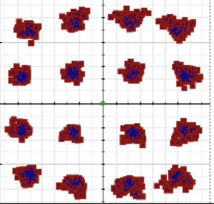
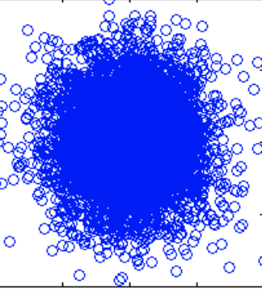
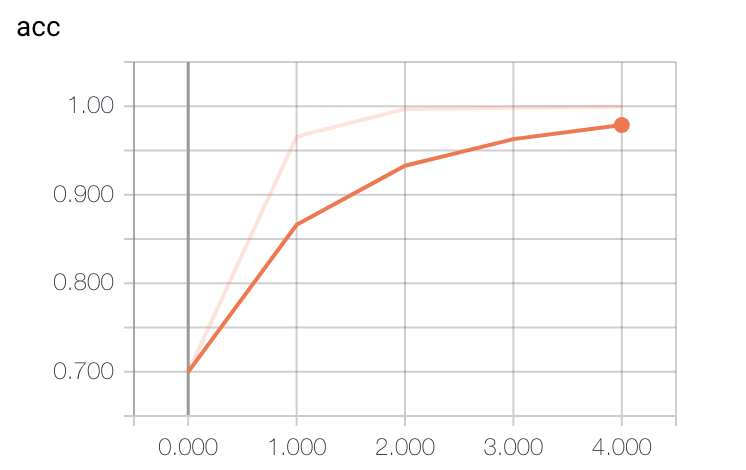
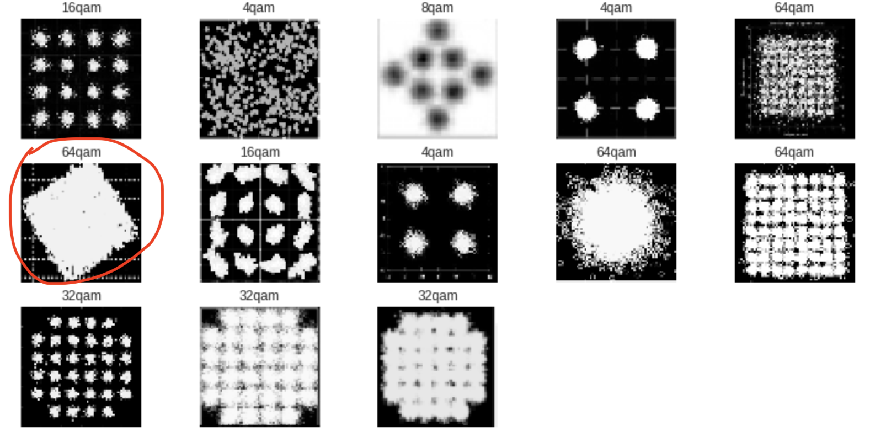

# QAM Modulation Classification with a Convolutional Neural Network

Originally developed for **CSE 400: Machine Intelligence with Deep Learning**, this project explores the classification of quadrature amplitude modulation (QAM) schemes from constellation images using a compact convolutional neural network (CNN).

The experiment considers five classes—4-QAM, 8-QAM, 16-QAM, 32-QAM, and 64-QAM—and investigates whether their spatial structure remains useful for classification under noisy conditions. This repository preserves the original implementation and experimental figures. The results below are historical observations, with limitations noted where the available code does not support independent verification.

## Background

QAM encodes information in the amplitudes of two orthogonal carrier components, conventionally called in-phase (I) and quadrature (Q). A constellation diagram represents the corresponding symbols in the I/Q plane. An M-point constellation carries log₂(M) bits per symbol; for example, 16-QAM carries four bits per symbol.

Higher-order QAM offers greater spectral efficiency, but at a fixed average symbol energy its constellation points are more closely spaced. This generally requires a higher signal-to-noise ratio (SNR) to maintain a given error rate. Noise and channel impairments can obscure the constellation structure, making modulation classification more difficult.

  
  

This project treats modulation recognition as an image-classification problem. It operates on rendered constellation images rather than directly on time-domain I/Q samples.

## Dataset and preprocessing

The original project report describes approximately 5,000 constellation images across the five modulation classes, with a reported signal-to-interference-plus-noise ratio (SINR) range of −30 to +30 dB. Image augmentation was used to expand the dataset. The included augmentation script references rotation, horizontal and vertical flips, translation, noise, zoom, and blur.

The training script:

1. Reads the modulation class from the filename prefix, such as `16qam` in `16qam.example.png`.
2. Loads each image in grayscale and resizes it to 64 × 64 pixels.
3. Encodes the class as a five-element one-hot vector.
4. Shuffles the images before training.

The implementation uses pixel values without explicit normalization. The dataset, signal-generation procedure, SINR calculation, and original split manifest are not included. Consequently, the reported noise range and independence of the training and test sets cannot be verified from this repository alone. SNR and SINR are distinct quantities; the original report does not provide enough information to resolve how noise and interference were modeled.

## Model architecture

The model in `pre.py` uses three convolutional blocks followed by a fully connected classifier. Convolutions use a stride of 1 and `same` padding. Max-pooling layers use 5 × 5 windows, their default stride of 5, and `same` padding.

| Layer | Output shape, excluding batch | Parameters |
| --- | --- | ---: |
| Grayscale input | 64 × 64 × 1 | 0 |
| 5 × 5 convolution, 32 filters, tanh | 64 × 64 × 32 | 832 |
| 5 × 5 max pooling | 13 × 13 × 32 | 0 |
| 5 × 5 convolution, 50 filters, tanh | 13 × 13 × 50 | 40,050 |
| 5 × 5 max pooling | 3 × 3 × 50 | 0 |
| 5 × 5 convolution, 80 filters, tanh | 3 × 3 × 80 | 100,080 |
| 5 × 5 max pooling | 1 × 1 × 80 | 0 |
| Dropout, rate 0.25 | 1 × 1 × 80 | 0 |
| Flatten | 80 | 0 |
| Dense, 512 units, tanh | 512 | 41,472 |
| Dropout, rate 0.50 | 512 | 0 |
| Dense, 5 units, softmax | 5 | 2,565 |
| **Total** | | **184,999** |

Training uses Adam with a learning rate of 0.001, categorical cross-entropy loss, a batch size of 32, and four epochs. Softmax produces the class probabilities; categorical cross-entropy is the optimization objective.

## Original experimental results

The original report recorded the following classification accuracies:

| Training epochs | Reported test accuracy |
| ---: | ---: |
| 2 | Approximately 98%, with some runs reported at 100% |
| 4 | 100% |
| 10 | 95% |

These figures are retained as **historical reported results**, rather than independently reproduced benchmarks. The checked-in training script loads test images but does not evaluate the model or generate these accuracy summaries. The exact test-set size, split membership, random seeds, and per-run measurements are not available in the repository.

The original report also recorded approximately 90 seconds of training for four epochs on 3,000 images using a 3.5 GHz CPU. This is an approximate historical timing, not a controlled hardware benchmark. Inference latency and end-to-end signal-processing throughput were not measured.

### Preserved experimental figures

Training accuracy from the original four-epoch experiment:

  

Example predictions associated with the reported four-epoch result:

  

Example predictions associated with the reported ten-epoch result:

  

The difference between the four- and ten-epoch results does not, on its own, establish overfitting. That conclusion would require validation learning curves and repeated experiments with controlled data splits and random seeds.

## Limitations and interpretation

The original results suggest that a small CNN can learn discriminative structure in the constellation-image dataset used for this course project. They do not establish generalization to independent radio captures or reliable operation across the full reported SINR range.

Important limitations include:

- **Split independence:** The repository does not establish whether augmentation occurred before or after splitting the data. Related images appearing in both training and testing could inflate measured accuracy. A stronger evaluation would split by original signal realization or capture, keeping all derived images in the same partition.
- **Noise-dependent performance:** Aggregate accuracy does not describe performance at individual SNR or SINR levels. Per-level accuracy, class counts, and confusion matrices would be needed to assess robustness under noisy conditions.
- **Rendering effects:** Image classifiers may exploit plotting styles, scaling, or other rendering artifacts. Consistent rendering and evaluation on independently generated signals would help distinguish modulation recognition from dataset-specific shortcuts.
- **Physical validity of augmentation:** Generic image transformations are not necessarily faithful models of radio-channel impairments. Their effects on class identity and signal statistics require validation.
- **Model selection and uncertainty:** The original runs do not include a documented validation protocol, repeated-seed summaries, or uncertainty estimates. Comparisons among activations and training durations should therefore be treated as exploratory.
- **Real-time operation:** Short training time does not demonstrate real-time inference. Such a claim would require measurements of inference latency, constellation construction, observation duration, and throughput on a specified platform.

A follow-up study could compare this image-based approach with conventional signal-feature baselines and models trained directly on I/Q samples, using independent held-out signals and a reproducible evaluation protocol.

## Repository contents and implementation status

| Path | Description |
| --- | --- |
| `pre.py` | Image loading, label encoding, CNN construction, and training |
| `data.py` | Command-line image augmentation script |
| `readme_images/` | Constellation examples and figures from the original project |

The code is a legacy course-project implementation and is **not runnable as supplied**:

- `pre.py` contains placeholder training and test paths that must be replaced with dataset locations.
- The dataset is not included.
- `data.py` uses Python 2 print syntax and imports `counter` and `ops.*` modules that are not included.
- The training script uses older Keras APIs, and no pinned dependency environment is provided.
- Training runs at import time; model saving and test-set evaluation are not implemented in the supplied script.

The training script imports NumPy, OpenCV, tqdm, TensorFlow, Keras, and Matplotlib. The augmentation script additionally imports scikit-image and the missing helper modules noted above. Reproducing the experiment would require restoring the data and dependencies, updating the legacy APIs, and adding an explicit evaluation workflow.

## References and acknowledgments

- **CSE 400: Machine Intelligence with Deep Learning**, Dr. Qinru Qiu. Lecture 13: “Training Neural Networks.”
- Raghav Prabhu, [“Understanding of Convolutional Neural Network (CNN)—Deep Learning”](https://medium.com/@RaghavPrabhu/understanding-of-convolutional-neural-network-cnn-deep-learning-99760835f148).
- [“Activation Functions in Neural Networks”](https://towardsdatascience.com/activation-functions-neural-networks-1cbd9f8d91d6).
